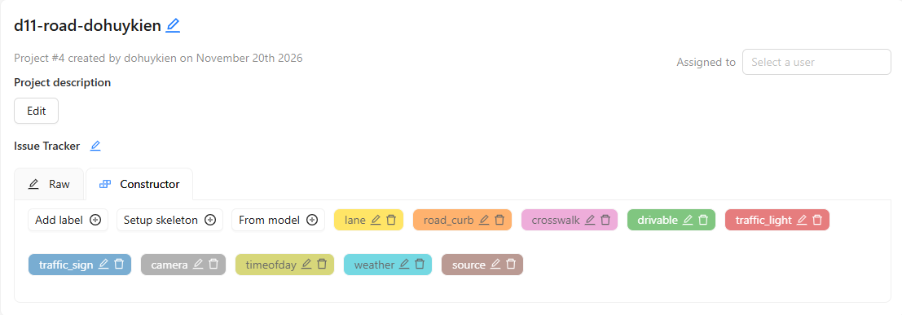
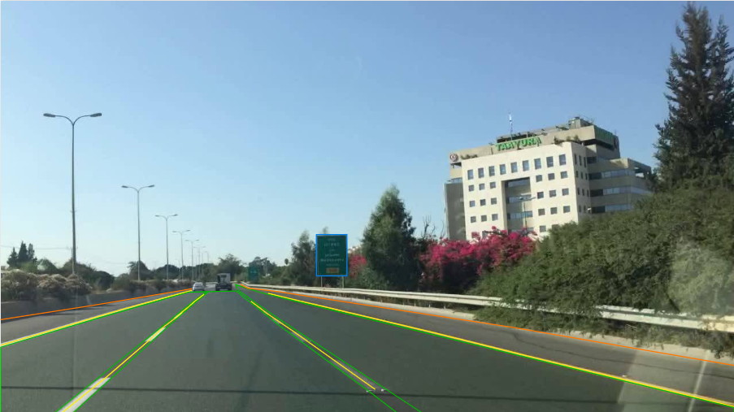
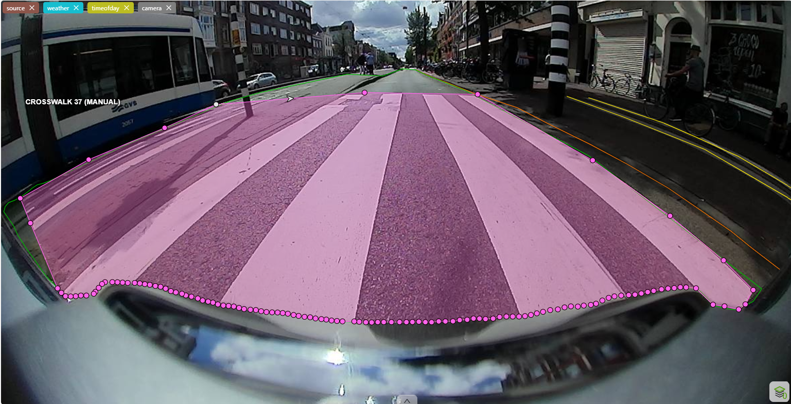
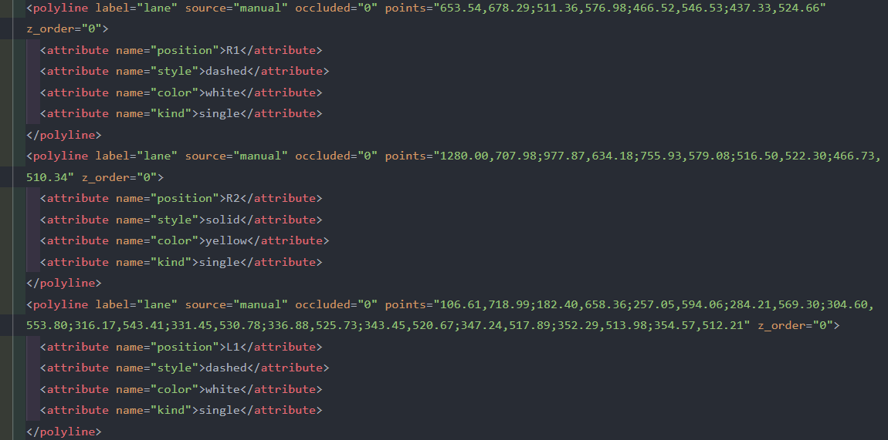

# Báo cáo cá nhân — Ngày 11
Họ tên: Đỗ Huy Kiên               Mã học viên: 2A202603216  
Phiên bản CVAT (Help → About): CVAT v2.82.0 (VinUni Lab)  
Guideline: Road v1.0    Lần nộp (`revision` trong manifest): 2  
Thời điểm export (ngày giờ trên CVAT): 2026-11-21 11:22 UTC+7    Số lần nộp lại sau Rework: 1  

## 1. Kiểm project
| Mục | Đúng như guideline Road v1.0? | Ghi chú |
| --- | --- | --- |
| 6 label, đúng kiểu | Đúng | Đủ 6 shape labels: lane (polyline), road_curb (polyline), crosswalk (polygon), drivable (polygon), traffic_light (rectangle), traffic_sign (rectangle) |
| Thuộc tính và giá trị | Đúng | Khớp 100% với taxonomy Road v1.0 (các thuộc tính select và checkbox edge_zone) |
| 4 tag ảnh | Đúng | camera, timeofday, weather, source dạng Tag với đúng 1 thuộc tính select tên là 'value' |
Cách kết thúc polyline trên bản CVAT này: Nhấn phím N trên bàn phím (hoặc click đúp chuột tại điểm kết thúc).  
Cách đặt tag ảnh trên bản CVAT này: Chọn công cụ Tag ở thanh bên trái, chọn label tag tương ứng, mở tab Objects -> Details để chọn giá trị `value`.  

## 2. Số lượng đã gán
| Task | Ảnh | lane | road_curb | crosswalk | drivable | traffic_light | traffic_sign |
| --- | ---: | ---: | ---: | ---: | ---: | ---: | ---: |
| front | 12 | 39 | 15 | 7 | 28 | 17 | 11 |
| front-extra (đã làm 0 / 4) | 0 | 0 | 0 | 0 | 0 | 0 | 0 |
| fisheye | 8 | 17 | 9 | 12 | 11 | 4 | 5 |
| fisheye-extra (đã làm 0 / 4) | 0 | 0 | 0 | 0 | 0 | 0 | 0 |

## 3. Bảng ca khó
| Ảnh | Nhãn | Phân vân giữa | Đã chọn | Lý do |
| --- | --- | --- | --- | --- |
| A05 | lane | Vẽ vạch ảo hay không vẽ | Không vẽ L1/R1 | Làn đường không có vạch sơn mép rõ ràng, tuân thủ nguyên tắc không vẽ vạch suy diễn; được miễn trừ QC1-02 theo checkpoint |
| A07 | lane | Có vẽ L1 mép trái không | Không vẽ L1 | Mép trái sát dải phân cách chỉ có bó vỉa gờ đá cứng, đã gán `road_curb` thay vì `lane` |
| B03 | lane | Vẽ đường thẳng hay uốn theo cung | Vẽ polyline nhiều điểm uốn theo cung cong | Ống kính fisheye làm cong vệt sơn, phải bám sát cung méo quang học sai lệch <= 5 px |
| B06 | lane | Đặt position là L1/L2 hay other | other | Quy tắc bắt buộc cho camera sườn xe (MVL/MVR): không có làn xe chạy thẳng nên toàn bộ position phải gán 'other' |
| B03 | traffic_sign | edge_zone bật hay tắt | edge_zone = true (bật) | Tâm bounding box của biển báo nằm ngoài bán kính 80% từ tâm ảnh ra rìa ngoài |

## 4. Phiếu QC 1 nhận được
Bạn kiểm lô của tôi: Nguyễn Đức Cường (`nguyenduccuong`)    Quyết định nhận được: Rework  
| Mã lỗi | Số lỗi | Đồng ý? | Đã sửa? |
| --- | ---: | --- | --- |
| QC1-01 (tag camera) | 2 | Đồng ý | Đã sửa (B01, B02 đổi giá trị từ front sang fisheye_front) |
| QC1-03 (position camera sườn) | 9 | Đồng ý | Đã sửa (B06, B07, B08 đổi toàn bộ vạch sang position=other) |
| QC1-05 (vạch đứt bị tách) | 8 | Đồng ý | Đã rà soát trên CVAT |

## 5. Kiểm file export
| File | Mở lại được? | Số shape ảnh 1 (job / file) | Số shape ảnh 2 (job / file) | Tag camera có trong XML? |
| --- | --- | --- | --- | --- |
| dohuykien-front.zip | Có | 10 / 10 | 9 / 9 | Có (`<tag label="camera"><attribute name="value">front</attribute></tag>`) |
| dohuykien-fisheye.zip | Có | 7 / 7 | 4 / 4 | Có (`<tag label="camera"><attribute name="value">fisheye_front</attribute></tag>`) |

## 6. Ảnh chụp màn hình
1. Tab Labels của project.  

2. Một ảnh camera trước đã gán đủ (làn, vùng lái, đèn/biển).  

3. Một ảnh fisheye đã gán, phóng to đoạn polyline cong.  

4. Một đoạn XML có `<polyline label="lane">`.  

## 7. Tự đánh giá
Lỗi bạn mắc nhiều nhất hôm nay (theo mã QC1-xx), và cách tránh ở Ngày 20:  
- **Lỗi mắc nhiều nhất:** Mã **QC1-03** (gán nhầm position L1/R1/L2 trên camera sườn thay vì `other`) và **QC1-01** (để sót giá trị mặc định của tag camera là `front` trên ảnh fisheye).
- **Cách tránh ở Ngày 20:** Thiết lập thói quen kiểm tra ODD/Metadata ngay khi tải ảnh: nhìn hậu tố tên file (`_FV`, `_RV`, `_MVL`, `_MVR`) để gán chính xác tag camera đầu tiên; đồng thời ghi nhớ quy tắc trục hình học: camera hai bên gương (`MVL`, `MVR`) nhìn ngang nên 100% vạch sơn phải mang thuộc tính `position = other`.

Nhãn của bạn đi vào model ở đâu? Chọn một lỗi đã sửa và nói nó làm model học sai thế nào:  
- **Vị trí đi vào model:** Dữ liệu nhãn polyline của `lane` đi vào module phát hiện làn đường (Lane Detection) và nội suy điểm neo hàng (Row-Anchor) để làm đầu vào cho bài toán Giữ làn đường tự động (Lane Keeping Assist - LKA) và điều khiển vô lăng.
- **Tác động nếu gán sai:** Nếu gán sai tag camera thành `front` trên ảnh mắt cá (`fisheye_front`), mô hình sẽ học các vạch cong méo quang học mắt cá như thể đó là đường cong thực tế nhìn qua camera chuẩn. Khi triển khai lên xe thật, hệ thống LKA sẽ tính toán sai hoàn toàn bán kính cong của làn đường, điều khiển vô lăng ngoặt gấp đột ngột gây mất kiểm soát phương tiện.

## 8. (Tùy chọn, buffer) Từ polyline đến đích row-anchor
| y | 720 | 680 | 640 | 600 | 560 |
| --- | ---: | ---: | ---: | ---: | ---: |
| x của chúng tôi | không có làn | không có làn | 599.8 | 543.7 | 486.4 |
| x của bạn kia | — | — | — | — | — |

TrẢ lời 3 câu:

1. **Năm số x đó chính là đích mà một model row-anchor học cho vạch này. Nếu bạn dừng polyline sớm 40 px, hàng nào đổi thành "không có làn"?**  
   $\rightarrow$ **Trả lời:** Nếu polyline dừng sớm 40 px (chỉ vẽ đến hàng $y=600$ thay vì vươn tới $y=560$), thì hàng xa nhất là **$y=560$** sẽ không còn điểm nội suy và bị chuyển thành trạng thái **"không có làn"**. Điều này làm mô hình học máy bị mất điểm neo ở tầm xa, khiến hệ thống xe tự hành mất khả năng nhận diện sớm quỹ đạo đường đi khi xe di chuyển ở tốc độ cao.

2. **So với bạn được kiểm (cùng ảnh): ở hàng 720 và hàng 560, hai bạn lệch nhau bao nhiêu pixel? Lệch ở hàng nào ảnh hưởng LKA nhiều hơn (slide 25)?**  
   $\rightarrow$ **Trả lời:** Lệch ở hàng **$y=720$ (ngay sát đầu xe)** ảnh hưởng nguy hiểm tới hệ thống LKA hơn rất nhiều so với hàng $y=560$. Hàng 720 đại diện cho vị trí tức thời của xe so với tim làn (lateral deviation); sai lệch chỉ vài pixel ở khoảng cách gần này sẽ khiến thuật toán điều khiển phản hồi tức thì với góc đánh lái lớn, gây hiện tượng lắc đảo vô lăng nguy hiểm. Ngược lại, sai lệch nhỏ ở hàng 560 (tầm nhìn xa) chỉ ảnh hưởng đến việc lập kế hoạch quỹ đạo trước và có thể bù trừ dần khi xe tiến lại gần.

3. **Nếu polyline vẽ từ xa về gần (ngược quy tắc 2), cách tính trên có đổi không? Script nào sẽ gặp khó?**  
   $\rightarrow$ **Trả lời:** Về mặt toán học hình học, tập điểm là một đường; tuy nhiên các thuật toán trích xuất điểm neo hàng (`rowanchor.py`) duyệt các đoạn thẳng có hướng đi từ đáy ảnh lên ($y$ giảm dần). Nếu vẽ ngược từ xa về gần, script sẽ phải xử lý đảo ngược thứ tự mảng điểm; đặc biệt, script kiểm định chất lượng tự động (`road_check lint/check`) sẽ bắt ngay lỗi mức CHÍNH mã **QC1-04** (vẽ ngược chiều) vì vi phạm quy ước chuẩn hóa dữ liệu đầu vào của pipeline huấn luyện AI.
